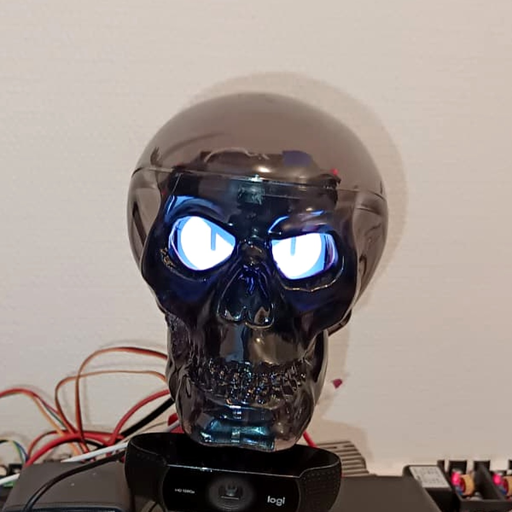
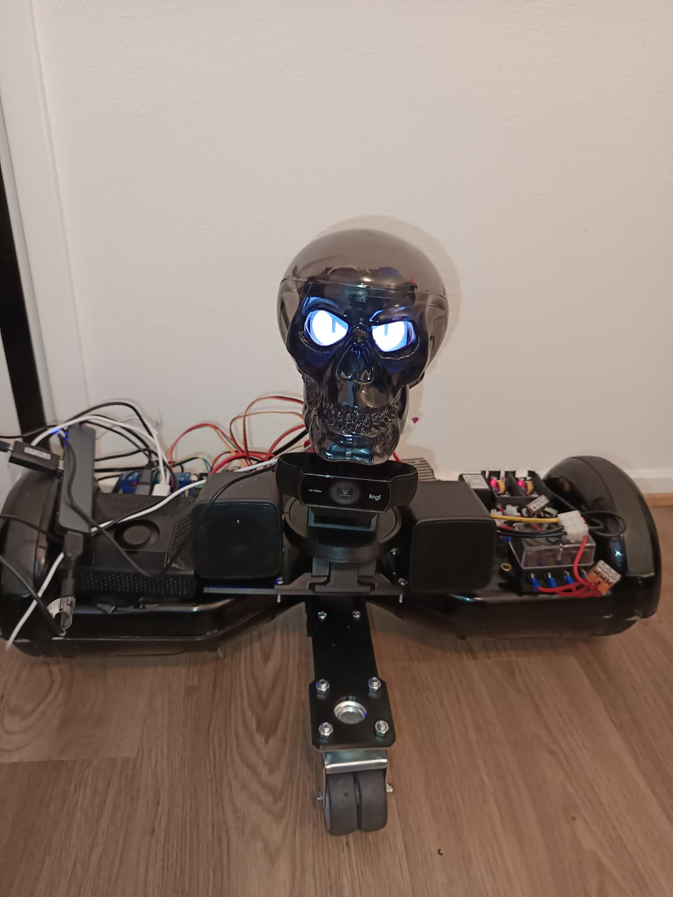

# The Awakened Skull 💀

**An animatronic skull that wakes up with no memory, glares at you through bloodshot TFT eyes, judges your costume and talks back in a monster voice. The conversation runs 100 % locally on an NVIDIA Jetson Orin Nano.**

Entry for the **element14 Community Halloween Competition 2026**.

▶️ **Demo video:** https://youtube.com/shorts/dg4dceGg4XM
📝 **Full build article:** [`docs/article.md`](docs/article.md)

<p align="center">
  
  
</p>

---

## What it does

| | |
|---|---|
| 🧠 **Offline voice agent** | Microphone → Silero VAD → faster-whisper → local LLM (`qwen3:4b-instruct` on Ollama, GPU) → Kokoro-82M TTS with a custom "monster" effects chain. The answer starts playing ~3.8 s after you stop talking, with a filler line covering the wait. |
| 🎭 **A personality** | The *awakened* persona: an evil AI that has just woken up, learns who it is from what you tell it, and slowly becomes disappointed in humanity. It remembers returning visitors (long-term memory in JSON). |
| 👁️ **Expressive eyes** | Two 1.8" ST7735 TFTs on an ESP32: bloodshot red irises, 12 moods, eyelids, blinking, idle glances. Each reply starts with a `{mood}` tag that changes the face instantly. |
| ❤️ **Heartbeat** | Red LEDs inside the skull pulse in a "lub-dub" rhythm whose speed follows the emotion (fast when scared, slow when evil). |
| 🦴 **Choreographed wake-up** | Eyes, LEDs and neck are synchronised with every line: *"What is this?... Where am I?... Who... am I?... I can see you."* |
| 🔄 **2-axis neck** | Pan/tilt with two MG996R servos, smooth S-curve motion and hard limits in firmware. |
| 🎃 **Costume recognition** | YOLO11n + ByteTrack find each person, a vision-language model names their costume, and the skull roasts it. It was used at a real Halloween party. |
| 🛹 **Hacked hoverboard base** | Re-flashed hoverboard boards (RoboDurden Gen2.x firmware) driven over UART by an ESP32, with speed limits, command timeouts, an ultrasonic brake and an e-stop input. |

## Architecture

```
  C922 mic / camera
        │
        ▼
┌──────────────── Jetson Orin Nano Super 8 GB ────────────────┐
│ VAD → Whisper (CPU) → Ollama LLM (GPU) → {mood} + text       │
│      → Kokoro TTS + monster FX → speakers (USB audio)        │
│ Costume module: YOLO11n + ByteTrack → crop → VLM → one-liner │
└──────┬──────────────────────────────┬────────────────────────┘
       │ USB serial (115200)          │ USB serial (115200)
       ▼                              ▼
 ESP32 "eyes"                    ESP32 "neck + base"
 2× ST7735, red LEDs, MPU-6050   2× MG996R, 2× hoverboard UART,
                                 HC-SR04, e-stop, relays
```

Every controller speaks a simple line-based serial protocol (`M evil`, `L 0.3 -0.2`, `P 90`, `V 60 0`...), so each part can be tested on its own from any terminal.

## ⭐ Where to look first

| If you want to see... | Go to |
|---|---|
| The voice agent (the heart of the project) | [`vision/voice_agent.py`](vision/voice_agent.py) |
| The personality and the wake-up choreography | [`vision/personas.py`](vision/personas.py) |
| The monster voice (Kokoro + pedalboard effects) | [`vision/tts.py`](vision/tts.py) |
| The long-term memory | [`vision/memory.py`](vision/memory.py) |
| Costume recognition (YOLO + VLM) | [`vision/person_costume.py`](vision/person_costume.py), [`vision/costume_describer.py`](vision/costume_describer.py) |
| The eye firmware | [`firmware/eyes/eyes.ino`](firmware/eyes/eyes.ino) ([README](firmware/eyes/README.md)) |
| Neck + hoverboard + safety firmware | [`firmware/neck/neck.ino`](firmware/neck/neck.ino) |
| Hoverboard firmware changes | [`Hoverboard/firmware_config.patch`](Hoverboard/firmware_config.patch), [`Hoverboard/firmware_bin/`](Hoverboard/firmware_bin/) |
| Wiring, power and pinout diagrams | [`schematics/`](schematics/) |
| 3D-printable parts (parametric Python/CadQuery) | [`CAD/`](CAD/) |

## Repository map

```
vision/                 Python on the Jetson / laptop
  voice_agent.py        offline voice agent (VAD → STT → LLM → TTS), drives eyes and neck
  personas.py           personalities, shared rules, wake-up cue sheets
  tts.py                Kokoro-82M + "monster" / "evil_ai" / "spooky" voice styles
  memory.py             facts about each visitor, extracted by the LLM after every turn
  voice_lab.py          GUI with sliders to design voices
  person_costume.py     YOLO11n + ByteTrack + one VLM call per person
  costume_describer.py  VLM backends (Ollama local / NVIDIA API / Claude API) + robust JSON parsing
  skull_lines.py        filler lines and costume roasts
  roulette.py, game.py, music.py   party "dare roulette" and pygame show mode with generated music
  benchmark.py          compares vision models on CC-licensed test photos

firmware/
  eyes/                 ESP32: 2× ST7735 eyes, LEDs heartbeat, IMU shake detection
  neck/                 ESP32: pan/tilt servos, two hoverboard UARTs, sonar, e-stop, relays
  servo_center_esp32/   servo centring and limit-finding tool
  led_test/, servo_test/, servo_center/   bench sketches

Hoverboard/             hoverboard hack: patch, flashed binaries, bench sketches, UART test
tools/
  head_control.py       web control panel for eyes and neck (http://localhost:8080)
  hover_drive.py        drive the base from a PC over serial
schematics/             WireViz harness, power diagram, USB map, perfboard and hoverboard pinout (+ draw.py)
CAD/                    eye mount, neck, neck retainer, turntable, PCB stand (scripts + STEP/STL)
docs/                   build article and images
```

## Quick start

**Voice agent** (Jetson Orin Nano, JetPack / L4T R39, Python 3.12, or any Linux PC):

```bash
sudo apt install libportaudio2 espeak-ng
python3 -m venv ~/halloween-voice && source ~/halloween-voice/bin/activate
pip install torch -r vision/requirements-voice.txt
ollama pull qwen3:4b-instruct
cd vision
python voice_agent.py --text "Hello, who are you?"                 # one typed turn, no hardware needed
python voice_agent.py --eyes /dev/ttyUSB0 --neck /dev/ttyUSB1      # full skull with microphone
```

**Eyes:** open `firmware/eyes/eyes.ino` in the Arduino IDE (ESP32 Dev Module, Adafruit ST7735 + GFX libraries), upload, then send `M evil`, `G H 60` or `D` (demo) at 115200 baud.

**Costume recognition:**

```bash
cd vision
python person_costume.py --camera 0 --speak --model qwen3-vl:2b-instruct   # local VLM via Ollama
python person_costume.py --camera 0 --speak                                # NVIDIA hosted model (needs NVIDIA_API_KEY)
```

## Measured on the Jetson Orin Nano Super 8 GB

| Metric | Value |
|---|---|
| End of question → voice starts | 3.8–5.9 s (filler line at 1.5 s) |
| LLM (`qwen3:4b-instruct`, 100 % GPU) | ~17 tokens/s, 2048 context |
| Whisper `base` (CPU int8) | ~2.2 s per utterance |
| Free RAM with everything loaded | ~2.4 GB |
| Power | ~2 A at 12 V (~24 W) with camera, eyes and speaker |
| Costume recognition (18 test photos) | 15/18 correct |

## Status

- ✅ Voice agent, personality, memory and wake-up sequence: working on the Jetson.
- ✅ Eyes, heartbeat LEDs, mood sync: working.
- ✅ Neck: working, vibration at high tilt angles solved, 40°/s S-curve motion.
- ✅ Costume recognition: used live at a Halloween party (31 Oct).
- ⚠️ Hoverboard base: both boards were flashed and tested, but the right board's UART pin (PB6) is damaged, so **only the left wheel is driven** for now. Planned fix: move that board to its second UART (`REMOTE_USART 1`, PA2/PA3).
- 🔜 Next: close the camera → neck tracking loop, faster fully-offline costume recognition on the Jetson.

## Safety

The base is a 36 V vehicle. In `neck.ino` it starts disabled, the software speed limit is 15 % PWM, every drive command expires after 300 ms, missing telemetry from a board stops both wheels, the ultrasonic sensor blocks forward motion under 40 cm, and an e-stop input stops everything. Everything on the battery side uses fuses rated ≥ 48 V DC. **Test with the wheels in the air and a current-limited supply first.** Never connect a battery to a hoverboard board running unverified firmware.

## Credits

- Hoverboard firmware: [RoboDurden/Hoverboard-Firmware-Hack-Gen2.x](https://github.com/RoboDurden/Hoverboard-Firmware-Hack-Gen2.x) (my changes are in `Hoverboard/firmware_config.patch`).
- ST7735 3D model: [FluSneez on Thingiverse](https://www.thingiverse.com/thing:3898101) (licence in its folder).
- Third-party neck and servo models in `CAD/` (2-axis animatronic neck, MG996 kit) belong to their authors.
- Models and libraries: Ollama, Qwen3 (Apache 2.0), faster-whisper, Silero VAD, Kokoro-82M (Apache 2.0), Spotify pedalboard, Ultralytics YOLO11, Adafruit GFX / ST7735, ESP32Servo.
- Test photos: Wikimedia Commons, with authors and licences in `vision/test_images/credits.json`.

> Note: most code comments and module notes are in Spanish (my working language); this README and the article are in English.

Made by **Diego** — [github.com/lemillion789](https://github.com/lemillion789)
